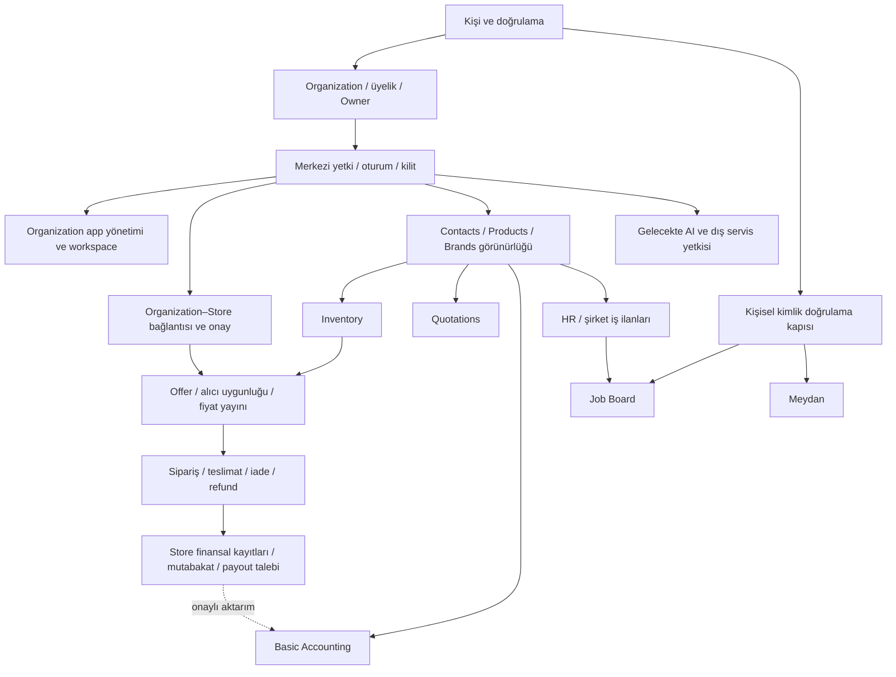

**Önerim: önce küçük fakat güvenli platform temeli, ardından tek bir uçtan uca pazaryeri modülü; sonraki büyük modüle yalnızca kabul onayından sonra geçilmesi.** Her modül kendi içinde küçük dikey dilimler halinde tamamlanmalı. Temel Muhasebe, İK, Meydan, İş Panosu ve AI/OEM çalışmaları aynı anda başlatılmamalı.

Bu A6 raporu bir **planlama önerisidir**. Mimari, güvenlik, ödeme ve ürün kararlarına uygulama onayı verildiği anlamına gelmez.

Durum etiketleri:

- **VERIFIED — Doğrulandı:** Yerel belge veya kaynakta doğrudan görüldü.
- **INFERRED — Çıkarım:** Kanıttan türetilen sonuç; çalışma zamanı doğrulaması yok.
- **RECOMMENDED — Öneri:** Ürün sahibi değerlendirmesine sunulan yaklaşım.
- **UNVERIFIED — Doğrulanmadı:** Bu incelemede kanıtlanmayan davranış veya tamamlanmamış karar.

### 1. Yönetici önerisi

**RECOMMENDED**

İlk hedef, bütün platform uygulamalarını hazırlamak değil, şu güvenli iş akışını tamamlamak olmalı:

> Doğrulanmış e-posta sahibi kişi → Organization oluşturma/katılma → yetkili çalışma alanına erişme → ayrı Store başvurusu → platform onayı → Offer yayımlama → uygun alıcının TRY siparişi → teslimat/iade → bağımsız Store ekstresi ve onaylı ödeme talebi.

Bunun iki teslim noktası vardır:

1. **En erken tamamlanabilir kullanıcı akışı:** Organization oluşturma, güvenli davet kabulü ve farklı yetkilerle Organization değiştirme.
2. **İlk ticari akış:** Onaylı Store’dan güvenli satın alma ve siparişin finansal kapanışı.

İkinci akış, ödeme sağlayıcısı, iade politikası, kur politikası ve finansal mutabakat onaylanmadan canlıya çıkmamalı. İlk akış ise bu kararlardan bağımsız olarak tamamlanabilir.

Takvim ve efor tahmini; kabul kriterleri, güvenlik PoC’leri ve sağlayıcı kararlarından sonra yapılmalı. Mevcut kanıt, güvenilir bir hafta/ay taahhüdü vermeye yeterli değil.

### 2. Doğrulanmış teknik temel ve yeniden kullanılabilir yetenekler

**VERIFIED**

- Kurulu backend paketleri **Mercur 2.3.6**, **Medusa 2.21.2**; kurulu Mercur dokümantasyonu **2.3.6**.
- Backend `withMercur` kullanıyor; Admin ve Vendor panelleri mevcut.
- Depoda ayrıca `apps/storefront` bulunuyor. Root proje ağacındaki özet bunun tamamını göstermiyor.
- Proje mimari belgesi mevcut durumu, DoğruAdres iş alanları uygulanmamış Mercur baseline’ı olarak tanımlıyor. İncelenen proje modül/link/workflow dizinleri bu tanımla uyumlu.
- Jest, SWC ve Medusa test araçları yapılandırılmış; incelenen HTTP testi sağlık endpoint’ini kontrol ediyor. Bu, alan veya güvenlik testlerinin mevcut olduğunu göstermiyor.
- Admin ve Vendor proje çeviri kaynaklarında İngilizce kayıtları var. Türkçe, Arapça ve RTL için tamamlanmış ürün desteği doğrulanmadı.
- Yerel dosya sağlayıcısı `/static` tabanlı URL kullanıyor.
- Backend konfigürasyonunda JWT ve cookie secret için `"supersecret"` fallback’i var. Üretim ortamının bunu geçersiz kıldığı doğrulanmadı.

Mercur belgelerinde mevcut olan yeniden kullanım adayları:

| Mercur yeteneği | DoğruAdres için kullanım | Sınır |
|---|---|---|
| Seller yaşam döngüsü | Store başvuru ve onay süreci | Legal Organization ile aynı kavram değil |
| Member / SellerMember | Store ekip erişimi için adaptasyon | Kanonik kişi ve Organization üyeliğinin yerine geçmez |
| Master katalog ve ürün incelemesi | Ortak pazaryeri ürün kataloğu | Organization-private ürün politikası ayrıca gerekir |
| Offer | Store’a ait SKU, fiyat, stok, sevkiyat ilişkileri | Orijinal döviz ve TRY yayın politikası hazır değil |
| Order Group ve seller bazlı siparişler | Çok satıcılı satın alma | DoğruAdres yetkisi ve finansal senaryolarla doğrulanmalı |
| Commission | Komisyon hesaplama altyapısı | Ticari oranlar, vergi ve iade etkisi onaylanmalı |
| Payout ve provider sözleşmeleri | Ödeme adaptasyonu için başlangıç | Store ödeme talebi modeliyle doğrudan eşit değil |
| Panel SDK ve workflow/link yapıları | Projeye ait ekranlar ve iş alanları | Her gereken hook ayrıca kaynakta doğrulanmalı |

**INFERRED:** Bu yapı pazaryerini yeniden yazmadan ilerlemeyi destekliyor. “Yeniden kullanılabilir” ifadesi, üretime hazır ve DoğruAdres kurallarına uygun olduğu anlamına gelmiyor.

**UNVERIFIED:** A1–A5 ve A3-R raporlarının ayrı yerel metinleri incelenen proje dokümanlarında bulunmadı. Bu mesajdaki sonuçları geçici mimari yön olarak kullanıldı; kabul edilmiş ADR sayılmadı.

### 3. İlk gerekli platform temelleri

**RECOMMENDED**

| Temel | İlk kabul standardı |
|---|---|
| Kanonik kişi ve kimlik eşlemesi | Bir kişinin farklı framework aktörleriyle ilişkisi açık; hesap birleştirme davranışı onaylı |
| E-posta doğrulama | Doğrulama durumu backend’de; token süresi, yeniden kullanım ve adres değişikliği kuralları belirli |
| Organization ve üyelik | Kişi birden çok Organization’a farklı yetkilerle erişebilir |
| Roller ve korunan Owner | Son Owner’ın kaybedilmesi engellenir; sahiplik devri ve kurtarma süreci onaylı |
| Merkezi yetkilendirme | Kimlik/tenant/yetki eksikliğinde erişim reddedilir; altyapı hatası izin üretmez |
| Organization–Store adaptasyonu | Bir Organization’ın birden çok Store’u olabilir; her Store ayrı onaylanır |
| Uygulama yönetimi | Sektör varsayılanları, aktiflik ve yetki ayrı değerlendirilir |
| Çalışma alanı ve launcher | Kişisel alan, Organization ve Store bağlamı açık görünür |
| Oturum iptali ve ekran kilidi | Eski erişim backend’de geçersizleşir; kilit yalnızca görsel örtü olmaz |
| Özel dosya erişimi | Finansal ve kişisel dosyalar nesne bazlı yetkilendirilir |
| Audit ve operasyon logları | Hassas değişiklikler izlenebilir; sırlar ve gereksiz kişisel veri loglanmaz |
| Bildirim altyapısı | Davet, onay ve fiyat değişikliği gibi gerekli olaylar güvenilir iletilir |
| Veri yaşam döngüsü | Deaktivasyon, arşiv, saklama ve silme ayrılır |
| TR / EN / MSA Arapça | İlk ekranlardan itibaren çeviri, RTL, bidi ve yerel biçimlendirme |

Branch için ilk aşamada kapsam ve erişim ilişkisi tanımlanmalı; tam şube operasyonları ihtiyaç duyulan modülde geliştirilmeli.

Gelişmiş arama ertelenebilir; ancak ilk listeler, filtreler, sayaçlar ve arama sonuçları başlangıçtan itibaren tenant güvenli olmalı.

### 4. Alan bağımlılık haritası

Aşağıdaki harita **RECOMMENDED** bağımlılıkları gösterir; mevcut uygulama haritası değildir.



Audit, özel dosya, loglama, bildirim ve yaşam döngüsü tüm dallara uygulanır.

Önemli sınırlar:

- Pazaryeri **Basic Accounting aktivasyonuna bağlı değildir**.
- Store finansal kayıtları Organization muhasebe uygulamasından bağımsızdır.
- Job Board ve Meydan erişimi **kişisel kimlik doğrulamasına** bağlıdır; Organization app entitlement’ına bağlanmaz.
- Vehicle Management, katalog ve Contacts ilişkilerinden yararlanabilir; OEM sağlayıcısına bağımlı olmamalıdır.

### 5. Önerilen modül sırası

**RECOMMENDED**

| Sıra | Tamamlanacak çalışma paketi | Geçiş koşulu |
|---|---|---|
| 0 | Karar paketi ve sınırlı teknik PoC’ler | Kimlik, yetki, Store ve finans sınırlarının onayı |
| 1 | Platform erişim temeli | Güvenli kişi–Organization–üyelik akışının kabulü |
| 2 | Workspace, app yaşam döngüsü ve ortak shell | Bağlam değişimi, deaktivasyon ve üç dil/RTL kabulü |
| 3 | Pazaryerinin ihtiyaç duyduğu katalog, marka ve stok dilimleri | Görünürlük ve stok sahipliğinin kabulü |
| 4 | Pazaryeri | Satıştan iade ve Store finansal kapanışına kadar kabul |
| 5 | Contacts’ın bağımsız kullanım kapsamı ve Quotations | Paylaşım ve teklif yaşam döngüsü kabulü |
| 6 | Native Basic Accounting | Mali uzman incelemesi ve defter bütünlüğü kabulü |
| 7 | Vehicle Management | Araç/fitment sahipliği ve doğruluk kriterlerinin kabulü |
| 8 | HR ve şirket iş ilanı yönetimi | Çalışan/adayı erişim ve yaşam döngüsü kabulü |
| 9 | Kişisel kimlik doğrulama, ardından Job Board | Kimlik kapısı ve başvuru gizliliğinin kabulü |
| 10 | Loyalty, referral ve temsilci alanı | Para, performans metriği ve Kumbara ayrımının kabulü |
| 11 | Meydan | Moderasyon, medya ve cross-post politikalarının kabulü |
| 12 | AI/OEM entegrasyonları | Gerçek kullanım ve sağlayıcı sözleşmesi onayı |

Bu sıralama sonraki uygulamaların ticari önceliğini kesinleştirmez. Özellikle 7–11 arasındaki sıra ürün sahibi tarafından değiştirilebilir. Yapısal bağımlılıkları korunmalıdır.

Paylaşılan alanların erken geliştirilmesi, bütün Contacts veya Inventory ürününü önden bitirmek anlamına gelmez: yalnızca aktif modülün gerekli, kabul edilmiş kapsamı tamamlanır.

### 6. İlk sürüm minimumu ve ertelenecek kapsam

**RECOMMENDED:** “İlk sürüm” için **güvenli ticari pazaryeri sürümü** tanımı öneriyorum. Ürün sahibi farklı bir lansman tanımlarsa kapsam yeniden onaylanmalıdır.

**İlk ticari sürümde gerekli:**

- Kişi, e-posta doğrulama, Organization, üyelik, davet, roller ve Owner koruması.
- Merkezi fail-closed yetki, iptal, ekran kilidi, audit, özel dosya ve işletim kontrolleri.
- App defaults, aktivasyon/deaktivasyon ve veriyi koruma davranışı.
- Workspace ve uygulama launcher’ının gerekli kapsamı.
- Organization başına birden çok Store; her Store için ayrı onay.
- Katalog/Offer/stok, alıcı segmentasyonu, en düşük uygun fiyat ve alıcı engelleme.
- Orijinal döviz fiyatının korunması, kontrollü TRY fiyat yayını, fiyat geçmişi ve sepet fiyat değişikliği bildirimi.
- TCMB geçmişi için **2005-01-01’den başlayan** veri kapsamı; eksik/tatil günleri ve para birimi bulunabilirliği açık raporlanmalı.
- Sipariş, teslimat, iptal, iade, refund ve komisyon.
- Store bazında bağımsız ekstre, kullanılabilir bakiye ve ödeme talebi.
- Türkçe, İngilizce, Modern Standart Arapça ve RTL.
- Yayına çıkış, yedekleme/geri yükleme ve başarısız finansal işlem işletim prosedürleri.

**Sonraya önerilen:**

- Basic Accounting’in kullanıcı uygulaması.
- Tam şube operasyonları ve gelişmiş birleşik arama.
- Tam Contacts/Quotations, Vehicle Management, HR.
- Loyalty, referral, temsilci ödemeleri ve Kumbara.
- Job Board, Meydan, AI ve OEM.

Kimlik doğrulama için genişletilebilir bir durum sözleşmesi erken tasarlanmalı. Job Board veya Meydan yayımlanacaksa gerçek doğrulama ve backend kapısı o sürümün engelleyicisidir.

Bu ertelemeler, kullanıcı kapsamından özellik çıkarmayı onaylamaz; **lansman kapsamı önerisidir**.

### 7. Güvenlik ve finansal kabul kapıları

**VERIFIED:** Kurulu permission middleware, resolver veya actor olmadığında `grantAll` atıyor ve `permissions_enforced = false` yapıyor. `requirePermission`, enforcement yoksa devam edebiliyor. A5’in ilk bulgusu yerel kaynakta doğrulandı.

**RECOMMENDED — zorunlu kapılar:**

| Kapı | Geçiş için kanıt |
|---|---|
| Fail-closed erişim | Resolver eksik/devre dışı/hatalı; actor veya tenant eksik senaryolarında korumalı işlem reddedilir |
| Güvenli davet | Token, amaçlanan doğrulanmış alıcı ve Organization’a bağlanır; süre, iptal ve tekrar kabul testleri geçer |
| Tüm giriş yolları | Admin/Vendor/Store API, workflow, job, export ve dosya erişimi matrisi tamamlanır |
| Erişim iptali | Üyelik/rol/oturum değişikliği eski token, cache ve bekleyen işlere uygulanır |
| Özel dosyalar | Başka tenant dosya kimliği, URL ve export üzerinden erişemez; kalıcı public URL üretilmez |
| App ve kişisel kapılar | Deaktif app, doğrulanmamış kişi ve kilitli oturum UI dışından işlem yapamaz |
| Owner koruması | Eşzamanlı demotion/removal son Owner’ı ortadan kaldıramaz |
| Üretim konfigürasyonu | Varsayılan secret ve gerekli güvenlik yapılandırması eksikliği üretim başlangıcını engeller |

Yetkilendirme yalnızca route üzerinde bırakılmamalı. Doğrudan workflow çağrısı ve güvenilir sistem aktörü yolları da açık kurallara sahip olmalı. Arama sayaçları ve hata mesajları da veri sızıntısı kapsamına alınmalı.

**Finansal kapılar:**

- Kesin tutar hesaplama, para birimi hassasiyeti ve deterministik yuvarlama.
- Aynı olayın yeniden gelmesiyle ikinci capture/refund/payout oluşmaması.
- Eşzamanlı taleplerin bakiyeyi iki kez kullanamaması.
- Store bazlı sipariş, komisyon, refund ve payout mutabakatı.
- Eski siparişin sonradan değişen kur veya komisyonla yeniden fiyatlanmaması.
- Kısmi iade, payout sonrası refund, chargeback ve sağlayıcı hataları için onaylı davranış.
- Harici transferin workflow compensation ile otomatik geri alınabileceğinin varsayılmaması.
- Pazaryeri finansal kontrol kayıtlarının Accounting kapalıyken de çalışması.

**Zorunlu uzman incelemeleri önerisi:** Canlı ödeme öncesinde ödeme/finans uzmanı; saklama, kimlik doğrulama ve aday/sosyal veri öncesinde hukuk/gizlilik uzmanı; üretim öncesinde bağımsız çok kiracılı güvenlik incelemesi. Basic Accounting öncesinde mali uzman çift kayıt ve düzeltme modelini incelemeli. Bunlar belirli bir hukuki yükümlülüğün kanıtı değil, önerilen yayın kabul kapılarıdır.

### 8–9. Küçük dikey dilimler ve test stratejisi

Aşağıdakiler gelecekteki geliştirme dilimleridir; bu incelemede çalıştırılmadı.

| Dilim | Gözlenebilir kabul sonucu | Gerekli test |
|---|---|---|
| P1 — Yetki PoC’si | Resolver yokken korumalı örnek işlem reddedilir | Unit karar matrisi, gerçek middleware sırası, doğrudan workflow negatif testi |
| P2 — Kişi ve e-posta | Kullanıcı doğrular; süresi dolmuş token kabul edilmez | Token unit, persistence integration, tekrar kullanım senaryosu |
| P3 — Organization ve Owner | Kurucu yetkili erişir; yabancı kişi erişemez | Tenant integration, IDOR, eşzamanlı son Owner işlemleri |
| P4 — Davet | Yalnızca amaçlanan doğrulanmış alıcı katılır | Yanlış kullanıcı/e-posta, iptal, süre ve eşzamanlı kabul |
| P5 — Bağlam ve iptal | Organization değişince doğru veri görünür; kaldırılan üye erişemez | İki Organization E2E, cache/eski token, işlem anı yetkisi |
| P6 — App yaşam döngüsü | Sektör değişimi aktif app’i kapatmaz; deaktivasyon veriyi silmez | Defaults unit, yetki integration, yeniden aktivasyon senaryosu |
| P7 — Kilit, dosya ve audit | Kilitli erişim reddedilir; özel dosya korunur; olay izlenir | URL/export negatif testleri, log redaction, kilit açma senaryosu |
| M1 — Store başvurusu | Aynı Organization’ın ikinci Store’u yeniden onay bekler | Lifecycle integration, yetkisiz onay ve Store izolasyonu |
| M2 — Katalog ve Offer | Onaylı Store kendi fiyat/stok kaydını yönetir | Offer ownership, özel/global görünürlük, stok rezervasyon yarışı |
| M3 — Kur ve yayın | Orijinal fiyat korunur; TRY sürümü izlenebilir | Kur/yuvarlama unit, eksik kur, idempotent yayın, tarihsel veri sözleşmesi |
| M4 — Uygun fiyat ve sepet | Alıcı yalnızca uygun fiyatı alır; değişikliği görüp onaylar | Segment/block negatifleri, gizli fiyat sızıntısı, checkout revalidation |
| M5 — Sipariş | Çok Store’lu sepet doğru bağımsız siparişlere ayrılır | Integration, retry, stok/ödeme hatası, kısmi iptal |
| M6 — İade/refund | Onaylı tutar doğru siparişe ve Store’a yansır | Kısmi/tam refund, tekrar webhook, payout öncesi/sonrası |
| M7 — Ekstre/payout talebi | Store bakiyesi bağımsızdır; aynı para iki kez talep edilmez | Finansal invariant, concurrency, provider contract, reconciliation |
| A1 — Muhasebe kayıt dilimi | Dengeli kayıt oluşur; düzeltme iz bırakır | Borç=alacak, atomiklik, replay, ters kayıt ve dönem kuralı |
| K1 — Kişisel uygulama kapısı | Kimliği uygun olmayan kişi Job Board/Meydan’a erişemez | API/workflow/dosya negatifleri, verification revocation |

TR/EN/Ar ve RTL kontrolleri her kullanıcı arayüzü diliminin kabulüne eklenmeli. Yalnızca son aşamada toplu çeviri yapılmamalı.

İlk PoC sırası: **yetki kapsaması → davet/kimlik eşlemesi → iptal ve özel dosya → fiyat yayını → ödeme/payout uyumu**. Muhasebe atomiklik PoC’si kendi modülünden önce yapılmalı.

### 10. Ürün sahibi onay noktaları ve Agent çalışma yöntemi

**RECOMMENDED**

Her büyük modül için aynı döngü uygulanmalı:

1. Açık iş kuralları ve örnek senaryolar netleştirilir.
2. Kabul kriterleri, veri sahipliği, güvenlik ve kapsam dışı alanlar onaylanır.
3. Fonksiyonel brief’ten ekranlar tasarlanır ve ayrıca onaylanır.
4. Küçük dikey dilim planı hazırlanır.
5. Agent’a tek, sınırları belli görev verilir.
6. Agent değişiklik, doğrulama, eksik davranış ve risk raporu sunar.
7. Ürün sahibi çalışan senaryoyu değerlendirir.
8. Eksikler aynı dilimde giderilir.
9. **Onaydan sonra** sonraki dilime geçilir.
10. Modülün kabul standardı tamamlanmadan sonraki büyük modül başlamaz.

Agent raporu; “ne değişti, hangi kabul kriteri karşılandı, hangi test neyi kanıtladı, ne doğrulanmadı, kalan risk nedir” sorularını yanıtlamalı. Derlenme başarı ölçütlerinden yalnızca biridir.

A6’nın onayı, bütün uygulama görevlerine toplu yetki sayılmamalı. Güvenlik, ödeme, veri sahipliği ve diğer anayasal kapılar ayrıca onaylanmalıdır.

### 11. Dokümantasyon stratejisi

**RECOMMENDED**

Gelecekte, yetki verildikten sonra:

- Kalıcı mimari/alan/güvenlik kararları ADR’ye kaydedilmeli; öneri ve kabul durumu ayrılmalı.
- Modül planları mevcut plan şablonunu izlemeli.
- Geçici A1–A5 önerileri kabul edildiğinde ilgili proje belgeleri uzlaştırılmalı.
- `CODEBASE.md` oluşturulursa yalnızca doğrulanmış mevcut uygulamayı anlatmalı.
- `AGENTS.md` kalıcı çalışma kurallarını içermeli.
- Görev raporları Agent yanıtında veya ayrıca yetkilendirilmiş rapor artefaktında kalmalı.
- `DESIGN.md` ve Stitch görselleri stil girdisi olarak kullanılmalı; ekran davranışı veya iş kuralı kaynağı yapılmamalı.

**VERIFIED:** Belgelerde `compose.dev.yml` sınıflandırması tutarsız: `PRINCIPLES.md` bunu proje altyapısı olarak ayırırken `MERCUR-INTEGRATION.md` geçici uyumluluk listesine koyuyor. Sonraki yetkili dokümantasyon bakımında uzlaştırılmalı. Bu raporda değiştirilmedi.

### 12. Karşılaştırmalar ve kapsam taşması riskleri

| Seçenek | Değerlendirme | Tercih |
|---|---|---|
| Foundation-first / marketplace-first | Tüm temeli eksiksiz yapmak değeri geciktirir; doğrudan pazaryeri tenant/yetki borcu yaratır | Küçük güvenli temel, hemen ardından pazaryeri |
| Tek büyük modül / dikey dilimler | Büyük modülün geç kabulü hata maliyetini artırır; çok modülü paralel açmak odağı dağıtır | Tek büyük modül, içinde onaylı küçük dilimler |
| Ortak bileşen / modül kopyaları | Kopyalar yetki, RTL ve bakım davranışını ayrıştırır | Kanıtlanmış ortak ihtiyaçlar; erken evrensel framework yok |
| Erken güvenlik PoC / frontend sonrası | UI sonrası yetki eklemek bypass yollarını ve veri modelini geç ortaya çıkarır | Önce gerçek backend girişleriyle PoC |
| Native Accounting / önce harici muhasebe | Harici servis tenant, lisans, veri eşleme ve hata bağımlılığı getirir | Pazaryeri finansal kontrolleri önce; native uygulama sonra |
| AI/OEM hazırlığı / erken entegrasyon | Erken SDK/provider seçimi gereksiz bağımlılık ve sözleşme riski yaratır | Dar sözleşme sınırları; ihtiyaç gelince entegrasyon |

Ek riskler: ortak katalog ile özel ürünleri aynı görünürlükte ele almak; Organization bakiyesinde Store’ları toplamak; fiyatı görüntülerken yetkilendirip checkout’ta kontrol etmemek; Kumbara’yı nakit bakiye gibi kullanmak; app deaktivasyonunu veri silmeye çevirmek.

### 13. Açık ürün kararları ve çözüm zamanları

**UNVERIFIED — uygulamadan önce karar gerekir**

| Karar | Çözülmesi gereken aşama |
|---|---|
| Kişi–customer–member–operator eşlemesi ve hesap kurtarma | Platform tasarımı öncesi |
| Organization doğrulaması, Owner devri/kurtarma, branch kapsamı | Organization dilimleri öncesi |
| Yetki öncelikleri, platform operator istisnaları, iptal süresi | Güvenlik PoC planı öncesi |
| Kilidin kapsamı; bekleyen işler ve bildirimler üzerindeki etkisi | Oturum/kilit dilimi öncesi |
| Sektör profilleri, app defaults ve yeniden aktivasyon | App yönetimi öncesi |
| Global/private Contacts, Products, Brands paylaşımı ve sahipliği | Ortak alan modellemesi öncesi |
| Uygun en düşük fiyat: miktar, vergi, kargo, kampanya, bağ kuralları | Fiyat seçimi öncesi |
| Buyer block kapsamı ve mevcut siparişe etkisi | Alıcı uygunluğu öncesi |
| TCMB kur türü, yayın zamanı, tatil/eksik gün, düzeltme ve stale kur | Kur PoC’si öncesi |
| TRY settlement’ın kesin onayı ve ödeme sağlayıcısı | Ödeme tasarımı öncesi |
| Komisyon/iade, rezerv, chargeback, payout talep ve onay kuralları | Finansal akış öncesi |
| Muhasebe hesap planı, dönem, döviz ve mevzuat kapsamı | Basic Accounting öncesi |
| Fiat performans metriği, temsilci ödemesi, Kumbara kazanım/harcama | Loyalty/temsilci modülü öncesi |
| Kimlik doğrulama yöntemi, seviye, süre ve iptal | Job Board/Meydan öncesi |
| Başvuru görünürlüğü ve saklama; Meydan moderasyonu/cross-post rızası | İlgili kişisel uygulama öncesi |
| Saklama, silme, hukuki hold ve export politikası | İlk gerçek verinin kabulünden önce |

Meydan’da ürün yorumunun cross-post edilmesi; orijinal yorum, sosyal gönderi, görünürlük, moderasyon ve silme ilişkileri açıkça kararlaştırılmadan uygulanmamalı.

### 14. AI/OEM hazırlığının sınırları

**RECOMMENDED**

Şimdi korunması gereken tasarım sınırları:

- Harici sistem kimlikleri ile kanonik kayıt kimlikleri ayrılmalı.
- Entegrasyon verilerinde kaynak, tarih, sürüm ve kullanım hakkı izlenebilirliği öngörülmeli.
- Organization-scoped servis aktörü, dar yetki ve audit yaklaşımı gelecekte genişletilebilir olmalı.
- ERP aktarımı muhasebe modülünün aktivasyonuna zorunlu bağımlılık yaratmamalı.
- VIN/OEM sonuçları kaynağı ve doğruluk düzeyi belli dış veri sayılmalı.

Sonraya bırakılacak uygulamalar:

- BYOK sır saklama, rotasyon ve provider SDK’ları.
- AI araç çalıştırma, insan onayı, harcama limitleri ve prompt injection kontrolleri.
- OEM cache, lisans ve veri zenginleştirme işleri.
- LexCom bağlantısı veya LexCom’a özgü model.

AI’ye kullanıcı oturumu devredilmemeli; gelecekte bağımsız Organization yetkisi, araç kapsamı ve onaylı işlem sınırı kurulmalı. **LexCom doğrulanmış partner değildir.**

### 15. Açık tercih

**RECOMMENDED: Güvenlik temeliyle başlayan, pazaryerine erken değer veren, tek modülü onaylı dikey dilimlerle tamamlayan geliştirme stratejisi.**

Bu yaklaşım ürün sahibinin “bir modülü bitir, sonra diğerine geç” tercihine uyar; tenant, kimlik, finans ve ortak veri sınırlarının sonradan yeniden yapılmasını azaltır. Mercur core değişikliği gerektiren bir engel çıkarsa otomatik patch/fork yapılmaz; anayasal eskalasyon ve onay süreci uygulanır.

### 16. Kanıt referansları

Yerel ve sürüm eşleşen kaynaklar temel alınmıştır:

- [AGENTS.md](D:/DogruAdres/AGENTS.md), [dokümantasyon router’ı](D:/DogruAdres/docs/dogruadres/README.md), [mimari](D:/DogruAdres/docs/dogruadres/ARCHITECTURE.md), [güvenlik](D:/DogruAdres/docs/dogruadres/SECURITY.md), [entegrasyon politikası](D:/DogruAdres/docs/dogruadres/MERCUR-INTEGRATION.md).
- [ADR indeksi](D:/DogruAdres/docs/dogruadres/adr/README.md), [plan şablonu](D:/DogruAdres/docs/dogruadres/plans/TEMPLATE.md), [DESIGN.md](D:/DogruAdres/DESIGN.md).
- [Backend paketleri](D:/DogruAdres/packages/api/package.json), [Medusa konfigürasyonu](D:/DogruAdres/packages/api/medusa-config.ts), [proje middleware’i](D:/DogruAdres/packages/api/src/api/middlewares.ts).
- [Mercur belge indeksi](D:/DogruAdres/node_modules/@mercurjs/docs/llms.txt), [Offer fiyat/stok](D:/DogruAdres/node_modules/@mercurjs/docs/content/platform/offer/concepts/pricing-and-inventory.mdx), [Order Groups](D:/DogruAdres/node_modules/@mercurjs/docs/content/learn/order-groups.mdx), [payout](D:/DogruAdres/node_modules/@mercurjs/docs/content/learn/payouts.mdx).
- [Permission middleware kaynağı](D:/DogruAdres/packages/api/node_modules/@mercurjs/core/.medusa/server/src/api/utils/permissions-middleware.js), [davet kabul workflow’u](D:/DogruAdres/packages/api/node_modules/@mercurjs/core/.medusa/server/src/workflows/seller/workflows/accept-member-invite.js), [Member modeli](D:/DogruAdres/packages/api/node_modules/@mercurjs/core/.medusa/server/src/modules/seller/models/member.js).
- [Test konfigürasyonu](D:/DogruAdres/packages/api/jest.config.js), [sağlık testi](D:/DogruAdres/packages/api/integration-tests/http/health.spec.ts).

Belge uyuşmazlığı: genel `seller-members.mdx`, e-posta benzersizliğini Store kapsamında anlatırken platform ekip belgesi ve kurulu Member modeli global benzersizlik gösteriyor. Kaynakta `deleted_at IS NULL` koşullu unique index görülüyor. Kanonik kişi tasarımı bu farkı göz ardı etmemeli.

Resmî çevrimiçi kaynaklar tamamlayıcı olarak incelendi: [Mercur dokümantasyon indeksi](https://docs.mercurjs.com/llms.txt), [Medusa Modules](https://docs.medusajs.com/learn/fundamentals/modules), [Medusa Workflows](https://docs.medusajs.com/learn/fundamentals/workflows). Kurulu sürüm davranışı için yerel kaynaklar önceliklidir.

[TCMB kurlar sayfası](https://www.tcmb.gov.tr/kurlar/kurlar_tr.html) resmî veri girişidir; bu A6 incelemesinde 2005’ten başlayan veri setinin bütünlüğü, erişim sözleşmesi ve tüm para birimi kapsamı doğrulanmadı.

### 17. Git durumu ve değişiklik yapmama teyidi

**VERIFIED:** Başlangıç ve bitiş Git durumu aynıydı:

```text
?? .vscode/
?? DESIGN.md
```

Tracked veya staged diff görünmedi. Mevcut untracked dosyalar korundu.

Dosya oluşturulmadı veya değiştirilmedi; bağımlılık kurulmadı; build, test, migration çalıştırılmadı; veritabanı, Git durumu, Stitch veya harici görev sistemi değiştirilmedi. Yol haritası uygulanmaya başlanmadı ve A7’ye geçilmedi.

**A6 önerisi ürün sahibi incelemesini bekliyor.**